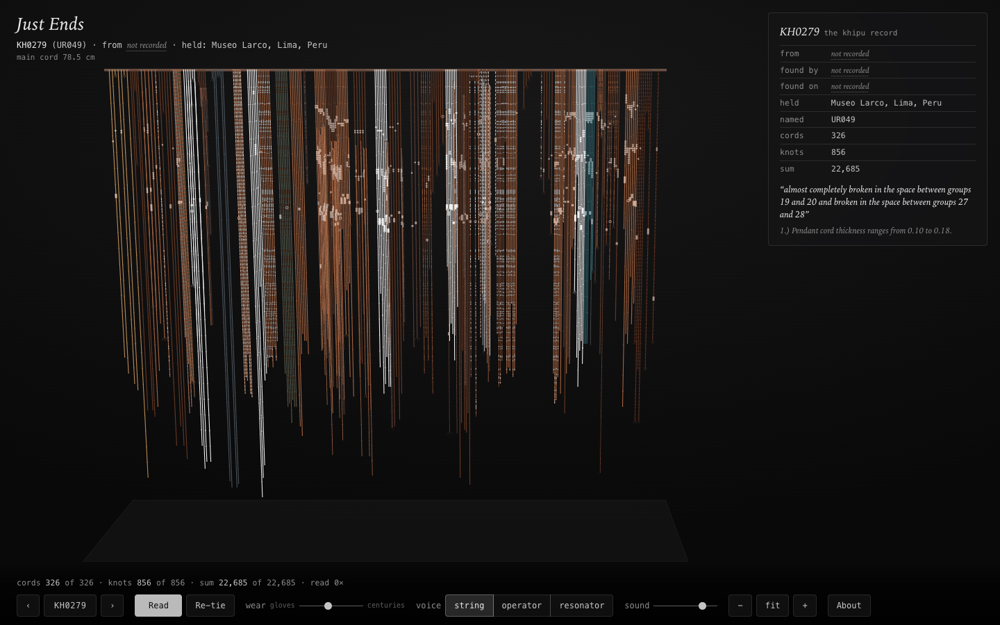
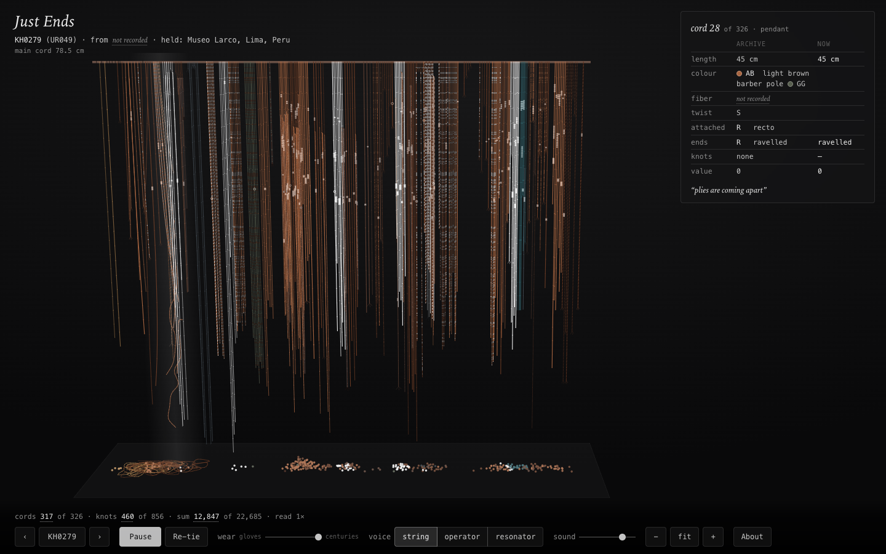
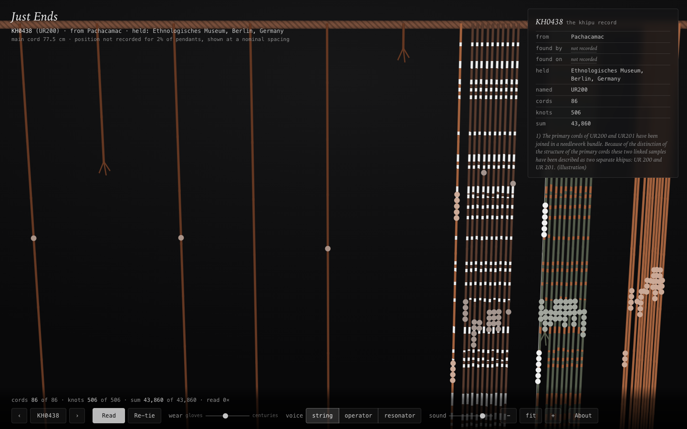
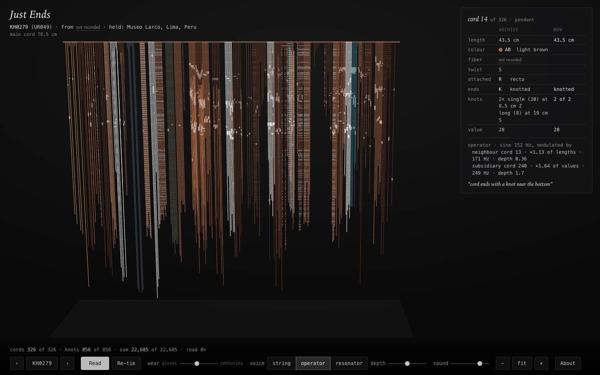
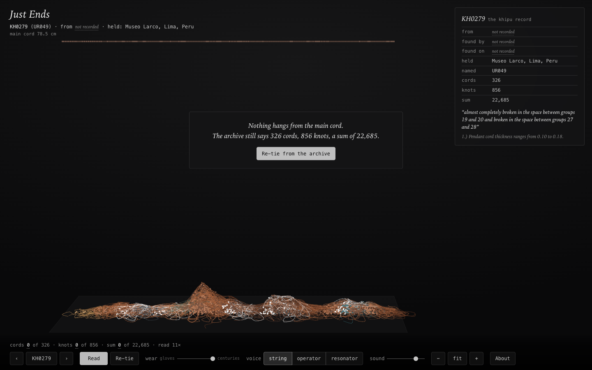
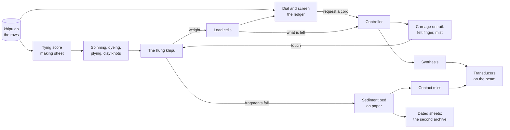

# Just Ends

**A proposal for an installation built from the khipu archive, with a working prototype**

Working title, taken from the database's own definition of termination code `U`:

> *unfinished: not knotted; not broken; not cut... just ends*

---

## 1. Summary

The piece I recommend is about the database, and only through it about khipus.

A khipu is a knotted-cord record, made and read by hand. The surviving ones are undeciphered. What the Khipu Field Guide and the Open Khipu Repository hold is a translation of those objects into relational tables: a cord becomes a row, a knot becomes a row, and whatever the person measuring did not think to look for becomes a blank.

*Just Ends* translates one of those khipus back out of the tables into cord and raw clay, hangs it in a room, and lets it be read. Reading is touch, and each touch costs the object something. Knots loosen and fall, cords part, and a bed of sediment builds underneath. Beside it, a ledger shows each cord's row twice: what the archive says, which never changes, and what is still hanging, which only shrinks. When the main cord hangs empty, the makers re-tie it from the rows, and it starts again, slightly greyer.

Four things are in this delivery:

| | where |
|---|---|
| This proposal | here, and copied to `docs/proposal.md` in the project |
| A working web prototype using all 619 khipus, with three sound voices | `app/` (run `npm ci`, then `npm run dev`; see the README) |
| An account of each sound algorithm and of the database columns it reads | `docs/sound_algorithms.md` |
| A tool that turns any khipu into a cord-by-cord making sheet at any scale | `tools/tying_score.py` |

What I have and have not verified. The data pipeline, the library and the mappings are covered by automated tests: all 619 khipus load, lay out and can be sounded in every voice, with totals that match the archive's. The sound was measured in Chrome by rendering it offline and analysing the result: the operator voice is frequency modulation at the index its patch states, the resonator rings at the pitches of the knot values for the time it is given, the three voices are within about 2 dB of one another, and the output stays under full scale with the largest allowed number of cords sounding at once. The interface, and the swinging and falling of the cords, were checked from screenshots of headless Chrome. **I have not heard it, and I have not watched it move in real time.** I had no way to listen, so the balance between cord and knot sounds, the depth of the modulation and the reverb level are my best guess and are the first thing to adjust by ear.

---

## 2. The data

### What I used

The Khipu Field Guide (KFG) is Ashok Khosla's site of schematic drawings and analyses. Its curated database has 703 khipus. The open data underneath it is the Open Khipu Repository (OKR), a SQLite file under an MIT licence, with 619 khipus. I built on the OKR file because it is downloadable and licensed. Moving to the KFG's larger, corrected set would mean asking Khosla for it.

The structure is a tree. Each khipu has a main cord. Pendant cords hang from it, subsidiary cords hang from pendants (up to six levels deep), and a few top cords point upward. Knots sit on cords in clusters, at measured distances from the top.

### What it contains

| | count | share |
|---|---|---|
| Khipus | 619 | |
| Cords | 54,403 | |
| Knots | 110,151 | |
| Total cord length recorded | 16.7 km | |
| Cords ending **knotted** | 37,692 | 69% |
| Cords ending **broken** | 9,392 | 17% |
| Cords ending **unfinished** | 3,000 | 6% |
| Cords ending **ravelled** | 2,190 | 4% |
| Cords with no knots at all | 17,321 | 32% |

Knots are single (74,642), long (26,291) or figure-eight (8,333), with a handful of rarer types. In the decimal reading established by Locke in 1912, single knots count tens, hundreds and thousands by their position on the cord, long knots count 2 to 9 by their number of turns, and a figure-eight knot is 1.

The colours are mostly undyed-looking: white (15,125 cords), light brown (9,815), moderate brown (8,167), dark brown (3,795). Reds, blues and greens are rare.

### What it does not contain

This is the part the piece is built on.

| The archive has no… | for | share |
|---|---|---|
| attachment direction (recto or verso) | 26,371 cords | 48% |
| fibre | 23,001 cords | 42% |
| thickness | 48,946 cords | 90% |
| twist direction | 9,432 cords | 17% |
| knot direction | 12,566 knots | 11% |
| place of origin | 221 khipus | 36% |
| name of a finder | 617 khipus | all but 2 |
| date of discovery | 619 khipus | all |
| position of pendants along the main cord | 25 khipus entirely, 70 partly | |

Four further facts matter to the concept:

- **Where they are.** 345 of the 619 are held outside Peru. 179 are in Germany, 154 of those in one museum in Berlin. 106 are in the USA.
- **Why some fields are blank.** The KFG notes that cord attachment was not acknowledged as a sign until the 1970s, so earlier recorders did not write it down. The schema records what each generation of scholars believed was signal.
- **The record can outlive the thing.** KH0082 is the largest khipu in the database, with 1,831 cords. The KFG says it and its companion KH0084 are missing and calls the entries "suspect". It exists now only as measurements.
- **The database knows what it is.** The OKR's own README calls the repository "one artifact of colonialist Archaeology and Anthropology" and notes that native speakers of Andean languages have had little involvement in collecting the data.

The free-text notes are also worth reading as found language. Two examples from the main-cord notes:

> *Another pendant, just after pendant 5, was probably present as indicated by the discoloration on the main cord.*

> *The brown color is disintegrating in places.*

---

## 3. The idea

### Premise

Most data art treats a dataset as raw material and asks what it can be turned into. Here the dataset is itself the last step of a long chain of translations, each made by someone with more power than the one before: a cord record made by a khipukamayuq, taken from a grave or a storehouse, sold or shipped to a museum, measured by a visiting scholar, typed into a table by an assistant, and then cleaned and renumbered. The piece adds one more translation and makes its cost visible.

### The questions it raises

1. **Is the record the thing?** The ledger's left column stays perfect while the object in front of you falls apart. KH0082 is the real case: the rows are all that is left.
2. **What does access cost?** In the installation, every request to see a cord's record is also a touch on the cord. A museum resolves this by keeping the object in a drawer and showing the record. This piece keeps them in the same room and lets the visitor decide.
3. **What did the measurers not think to measure?** The blanks are given a material and a sound of their own. They are the trace of what was believed not to matter.
4. **What is a translation without understanding?** Nobody can read these khipus. The piece does not decode anything. It makes the measurements audible and tangible, which is pleasurable, and the pleasure is part of the problem it shows: it is easy to make an undeciphered thing "speak" and mistake that for hearing it.
5. **Whose hands?** A khipu was made by hands and read by hands. Since then the hands have been those of excavators, dealers, registrars and data-entry assistants (the database still carries their login names). Now they are the visitor's.

### Why it is not data for its own sake

The test I applied: would the piece still work with a different dataset? A sonification of cord lengths would. This would not, for three reasons.

- **Its structure comes from the archive's own vocabulary of endings.** The database has exactly seven ways a cord can end: knotted, broken, cut, ravelled, doubled, unfinished, wrapped. Those seven words decide how each cord is finished by hand in the workshop and how each sound stops.
- **Its mechanism is the archive's own paradox.** Consulting wears. The data is the cause of the decay it documents.
- **Its second archive is made by destruction.** The sediment sheets (section 4) are new records, produced as the first one disappears.

### How original is it

I want to be straightforward about this, because parts of the territory are well occupied.

- **Khipu as contemporary art** has a long history. Cecilia Vicuña has made quipus since the 1960s, including *Quipu Womb* (2017) and *Brain Forest Quipu* (Tate Modern, 2022), and her work is centrally about disappearance. Jorge Eielson made knotted *Quipus* from the 1960s.
- **Khipu as sound and electronics** exists too. Constanza Piña's *Khipu: Electrotextile Prehispanic Computer* is a woven khipu that works as an antenna. Paola Torres Núñez del Prado works with textile, sound and machine learning.
- **Decay as method** is a tradition: Gustav Metzger's auto-destructive art, Tinguely's *Homage to New York*, and, closest to your musical background, William Basinski's *Disintegration Loops* and Alvin Lucier's *I Am Sitting in a Room*, where a sound documents the erosion of its own medium.

So "a khipu that sounds" and "a khipu that disappears" are both existing ideas. What I have not found is a work whose subject is the database translation itself: one that uses the archive's termination codes and blanks as its material, keeps the record and the object side by side, and makes consultation the cause of loss. That is the claim to originality, and it is a claim about a combination. These references are from my own knowledge, not from a literature search, so titles and dates need checking, and a proper prior-art review is the first milestone in section 7.

### A caution about position

Two artists outside the tradition, re-making an Andean object in order to destroy it, will be read politically whatever the intent. Some of the candidate khipus come from burials. Khipus are also still kept as community patrimony in some Andean villages. I would treat the following as part of the work and not as clearance:

- Talk to the OKR advisory board and to Khosla early. They are reachable and the README invites contact.
- Bring in a Quechua or Aymara speaking collaborator or adviser, paid, before the form is fixed.
- Keep the title in the database's English. I avoided a Quechua title on purpose: it would claim a closeness the project has not earned.
- Use earth from where the work is shown, not Andean earth.
- Say plainly in the work that it re-makes a record of a khipu, from measurements.

---

## 4. The installation

### What a visitor meets

A long room, low warm light from one side. A thick braided cord, three metres long, is slung under a beam above head height. From it hang eighty or so cords in whites and browns, the longest nearly reaching the floor. Along each cord are lumps of pale raw clay where the knots would be: small beads, long ridged ones, double-lobed ones. The cord ends differ. Some are knotted, some torn, some untwisted into loose plies, a few wrapped in red thread.

Under the cords is a shallow bed lined with a sheet of heavy paper. By the second day it carries a soft ridge of clay dust and fragments, densest under the groups that have been read most.

Beside the piece is a small screen in monospaced type and a single dial. Turning the dial moves through the cords. For each one the screen shows its row in two columns, *archive* and *now*. Pressing the dial asks for that cord to be read.

When it is, a carriage runs quietly along a rail above the main cord, stops, and a felt finger flicks the cord. A breath of mist follows. The cord swings. A sound comes from the beam itself: a plucked tone, then the knots ringing in order down the cord, then the ending. A bead that has been touched many times lets go and drops. You hear it land, amplified, from the bed. On the screen the *now* column loses a number. The *archive* column does not move.

Twice a day the carriage makes a full pass, cord by cord, left to right. On the wall behind, drawn in graphite at full scale, are the cords whose length nobody recorded.

### From field to material

Every decision below follows from a field in the row. The tying-score tool produces this as a making sheet (an example for KH0279 at four times scale is in `docs/tying_scores/`).

| In the row | In the room |
|---|---|
| Main cord length | A thick braid of undyed cotton, at 3× or 4× scale, slung under a beam |
| Cord length | Length of hand-plied cord, same scale |
| Cord colour | Naturally pigmented cotton for the whites, tans and browns that make up most of the data, so most cords are undyed. Cochineal, indigo and plant dyes for the rare reds, blues and greens. Two-colour cords are plied from two singles (barber pole) or spun from blended fibre (mottled), as the code says |
| Fibre | Cotton, or alpaca where the row says camelid. Where fibre is not recorded: decide once, and say so |
| Twist, S or Z | Plied in that direction |
| Knot | A bead of unfired clay pressed around the cord at the measured distance. Single knot: one small bead per knot. Long knot of *n* turns: one long bead with *n* pinched ridges. Figure-eight: two lobes. The value sets the mass |
| Ending | Made by hand as the code says: **knotted** with an end knot; **broken** torn, never cut; **cut** with one stroke of a blade; **ravelled** untwisted by hand; **doubled** folded back; **wrapped** in cochineal-red thread; **unfinished** left exactly where the spinning stopped |
| Length not recorded | Not made. Drawn on the wall behind in graphite, at the median length, as a dotted line |
| Pendant position not recorded | Hung at even spacing, with a pencil tick on the beam marking each guess |

Why raw clay for the knots: it holds a form, it has weight, it fails by touch and by damp, it leaves a residue that can be drawn with, and it can be gathered up and used again. Most of the khipus with a recorded origin come from the dry Peruvian coast (Pachacamac alone accounts for 90), where both the cords and the earthen architecture survived because it almost never rains. The piece brings a little water into that.

### The second archive

The paper under the cords is changed on a fixed schedule: daily, or at each re-tying. Each sheet is dated, left to dry with its sediment on it, fixed, and filed flat in an open rack in the room. Over the run the rack fills. These sheets are drawings made by the piece, which is where your collaborator's drawing practice meets the system directly: the choice of paper, whether the sediment is fixed or left loose, whether the sheets are worked into afterwards.

### The cycle

When little or nothing is left hanging, the two of you re-tie it in public from the rows: gather the sediment, wet it, press new knots, hang the cords again. The clay is the same clay, now mixed, so each generation is closer to one colour. Cords that parted are spliced or replaced and the repairs stay visible.

Whether this is a weekly ritual over a six-week run, or happens once, or never, is a real artistic decision. Re-tying says the record can always regenerate the object. Not re-tying says it cannot. The prototype has a Re-tie button so you can feel the difference.

### Sound

Here I have to correct the obvious idea. A hanging cotton cord cannot be an acoustic string. A cord a metre and a half long, a few millimetres thick, with a 200 g weight on it, vibrates at a few hertz: you see it swing, you do not hear a pitch. Getting it into audible range would need tens of kilograms of tension, which a khipu hung from a cord cannot carry.

So the sound has three layers, and only the first is computed:

1. **The cord voices.** Synthesised from the row at the moment of reading, using the model in the prototype (below), and played through tactile transducers bolted to the beam, so the object is the loudspeaker. The synthesis is driven by what is physically still there, measured by weight.
2. **The fall.** Contact microphones under the sediment bed pick up every fragment landing. This is real, acoustic and unrepeatable.
3. **The main cord.** A low tone tuned to the main cord's length, present for as long as anything hangs.

The first mapping, which is the prototype's **string** voice:

| In the row | In the sound |
|---|---|
| Cord length | Pitch, as if the cord were a string. No scale is applied. The tuning of each khipu is whatever its lengths are |
| Colour | Brightness and ring time |
| Knot position | A partial above the cord, at the ratio of cord length to knot position, like a harmonic touched on a string |
| Knot type | Single knots ping once each. A long knot of *n* turns is a roll of *n* grains. A figure-eight beats against itself |
| Knot direction | S left, Z right. Unknown: centre, partly noise |
| Ending | **Knotted** rings out. **Broken** tears off with a crack. **Cut** stops clean. **Ravelled** splits into strings that drift apart. **Doubled** adds the octave below. **Wrapped** is muted. **Unfinished** holds level and then just ends |
| Anything not recorded | Breath. A cord with no measured length has no pitch |

I avoided mapping to a pentatonic or any "Andean-sounding" scale. That would be the sonic equivalent of a costume.

### Three voices

The prototype now reads each row three ways. The cord, its wear and its ending are the same in all three. What changes is which part of the row is taken to be the sound. Each is set out in full, with the database columns it reads and what was measured, in `docs/sound_algorithms.md`.

| Voice | Takes the row as | What is heard |
|---|---|---|
| **String** | measurements | The table above |
| **Operator** | relationships | Every cord is a sine tone. The cord that is touched is bent (frequency-modulated) by the cords tied onto it and by the cord hanging before it in its group: how fast, by the proportion between the two cords' numbers; how deeply, by how much of the pair's number the other cord carries |
| **Resonator** | numbers | The cord is struck and a bank of resonant filters rings, one for each cluster of knots, tuned by its value: the digits 1 to 9 across an octave, each power of ten an octave higher. The length of the cord plays no part |

What each one says, and what it costs:

- **Operator.** A cord cannot be heard apart from what is tied to it. When a subsidiary falls, the cord it hung from loses a modulator, and when all have fallen it is a bare sine tone. The khipu gets simpler as it empties, and what is heard to go is relation, not loudness. In the archive two cords in three have at least one such relation before anything is worn. The voice does not look for sums (section 9): only 531 of the 8,985 cords that carry subsidiaries have subsidiaries that add up to them, and treating a tie as arithmetic would be decipherment by another door. It treats a tie as an influence, which is also a claim.
- **Resonator.** Equal numbers sound the same in every khipu, on a cord of any length or colour. This is the voice that takes the database's decimal values at their word, and it is the most legible of the three: a listener could learn to hear a 3. That is its attraction and its problem. When the knots have fallen the cord only taps.
- **String.** Still the voice that claims least. It sounds what was measured.

For the installation this is a decision to make by ear (section 8). It changes little in the hardware: all three are computed from what is still hanging, so all three follow the load cells in the same way.

---

## 5. The prototype

### What it is

A web app in TypeScript: React for the interface, three.js for the khipu, Tone.js for the sound, Tailwind for the styles, built with Vite. Run `npm ci` and `npm run dev` in `app/`; `npm run build` writes a static site that any web server can serve. All 619 khipus are in it. There are no samples: every sound is computed from a row. The interface is dark and monochrome, and the only colour on screen is the recorded colour of the cords.

The cords are simulated as ropes. A touched cord swings and comes back to rest. A cord that parts or comes away falls, bends as it falls, folds where it lands and stays there, on a bed that builds up under the khipu.

### What you can do in it

- Move across the cords to sound them, like a hand passing over them.
- Press **Read** for a full pass along the main cord. It repeats.
- Set **wear** from "gloves" (nothing is lost) to "centuries".
- Choose a **voice**: string, operator or resonator.
- Watch the ledger: archive on the left, now on the right, and under them what the voice makes of the cord in hand.
- **Re-tie** from the archive. The sediment from before stays.
- Open the catalogue and sort the 619 by size, by how broken they are, or by how little was recorded.

### What it is for

It lets you make four decisions before buying anything:

1. **Which khipu.** Size, density, how many kinds of ending, how much is unknown.
2. **How fast.** Whether the arc from full to empty should take an hour or a month.
3. **Whether to re-tie.**
4. **Which voice, and whether it holds up** over twenty minutes of listening, which is the test that matters.

### What it cannot tell you

- How it sounds through transducers on a beam.
- Whether raw clay behaves the way the wear slider pretends it does. The wear model is invented: each touch loosens each knot with a fixed chance, and a cord with no knots left begins to part. Real clay will have its own schedule, and the piece should follow the clay.
- Anything about scale, weight, light or smell.

### Other tools

- **Blender** is worth using next for one purpose: a to-scale model of the chosen khipu in the actual room, generated from the tying-score CSV, to settle scale and sightlines.
- **TouchDesigner** only becomes useful if you add projection or camera sensing. For load cells, a stepper and audio, it adds nothing the browser and a microcontroller cannot do. The string voice and the mappings of the other two voices are plain functions with no browser in them, so they can move to whatever runs the installation; only the parts that play the operator and resonator voices depend on Web Audio.

---

## 6. Technical design

### System

### Custom hardware

| Part | What | Notes |
|---|---|---|
| Beam and rigging | Timber or steel beam, 3.5 to 4.5 m, hung from two points | Carries the khipu, the rail and the transducers. Needs a structural check for the venue |
| Reading carriage | One linear axis: aluminium extrusion, belt, stepper motor with a quiet driver, limit switches | A camera-slider or small CNC axis. Must be near silent |
| The finger | A small servo with a felt or leather pad | Flicks one cord. Also test a pad that strokes downward |
| Mist | A small peristaltic pump and a fine nozzle on the carriage, fed from a bottle | Fractions of a millilitre per touch. Must never drip on electronics |
| Weighing | Two load cells where the beam hangs, with amplifiers | Total weight and left-right balance, so loss can be located roughly along the cord |
| Sound out | Two to four tactile transducers on the beam, a small amplifier, optionally one subwoofer | |
| Sound in | Two to four contact microphones under the bed, with preamps | |
| Controller | A microcontroller for motor, servo, pump and load cells. A small computer for the ledger and the synthesis | The prototype can run as the ledger in a kiosk browser (`?play` starts it without a click) |
| Ledger | A small matte screen and one rotary encoder with a push switch | No touchscreen. One dial keeps the gesture slow |
| Sediment bed | A shallow tray the length of the main cord, about a metre deep front to back, on a slight slope, lined with paper | Sheet changes must be easy |

Rough cost of the hardware above, excluding fibre, clay, paper, labour and venue: somewhere between US$1,500 and US$4,000. That is an estimate from typical hobby and pro-audio component prices, not from quotes.

### Skills needed

| Skill | For | Who |
|---|---|---|
| Hand spinning and plying, S and Z | All cords | Collaborator, possibly with a second spinner |
| Natural dyeing | The rare colours | Collaborator or a dyer |
| Clay bodies, unfired | The knots: adhesion, cracking, erosion | Collaborator. This is the least known area and needs testing first |
| Drawing, paper, fixing | Wall drawing and sediment sheets | Collaborator |
| Data and software | Pipeline, ledger, synthesis | You. Mostly done in the prototype |
| Sound design and DSP | Tuning the model by ear, transducer placement, contact mic gain | You |
| Embedded and motion control | Stepper, servo, pump, load cells | You, or a technician for a few days |
| Rigging and structure | Beam, load, safe hanging | A rigger or the venue's technician |
| Water and electrics in one object | Safe routing, drip protection | A technician's review |
| Research and relationships | Khipu scholars, Andean adviser, prior-art review | Both of you. Start in week one |
| Documentation | Photo, video, sound recording across the whole run | Someone other than the two of you, since the work destroys its own evidence |

---

## 7. Risks, milestones, timeline

### The risks that could sink it

| Risk | Why it matters | How to find out early |
|---|---|---|
| Raw clay does not erode at a usable rate | It may fall off in an hour or never. Everything depends on this | Milestone 1: twenty test cords with different clay mixes, bead sizes and amounts of mist, flicked on a schedule for two weeks |
| Wet cord confuses the weighing | Cotton takes up water and gets heavier as the clay gets lighter | Milestone 1: log weight through wet and dry cycles. If it is unusable, count falls with the contact mics instead |
| It is dull at room scale | The prototype is dense and quick. Eighty cords and one touch a minute may feel empty | Milestone 2: a one-metre section with twenty cords, run for a week, with people who have not seen it |
| The venue forbids water or loose dust | Common in galleries with other works nearby | Ask before Milestone 2. Fallback: no mist, wear by touch alone, or visitors' hands |
| The carriage is audible | Stepper whine would sit on top of everything | Milestone 2 |
| The work is received as appropriation | See section 3 | Conversations before the form is fixed, and willingness to change it |
| Spinning takes far longer than planned | 80 to 120 cords at 3× to 4× is 100 to 150 m of hand-plied cord | Milestone 1: time the first ten cords and multiply |

### Milestones

| # | Milestone | Proves | Stop or change if |
|---|---|---|---|
| 0 | **Ground.** Prior-art review, first conversations with OKR, KFG and an Andean adviser, venue rules, khipu shortlist | The piece is worth making and may be made | A near-identical work exists, or the people closest to the material object to the form |
| 1 | **One cord.** One cord, clay knots, a finger, mist, one load cell, one transducer, the synthesis | The whole chain works once. The clay has a rate. Spinning has a time | No clay mix gives a rate between hours and weeks |
| 2 | **One metre.** Twenty cords, the rail, the ledger, the bed, a week's run | It holds attention. The sound works on a beam. The sheets are worth keeping | It does not hold attention. Then rethink scale, speed or who does the touching |
| 3 | **Fabrication.** All cords, beam, bed, electronics | | |
| 4 | **Two full cycles** in the studio, documented | The arc from full to empty to re-tied | |
| 5 | **Install** | | |

### Timeline

This assumes the two of you part-time with occasional help, and it is a planning estimate. Milestone 1 will tell you how wrong it is.

| Weeks | Work |
|---|---|
| 1 to 3 | Milestone 0. Use the prototype together to shortlist khipus and decide on re-tying. Choose the voice and tune it by ear |
| 2 to 8 | Milestone 1. Clay tests run in parallel with the single-cord rig. First ten cords spun and timed |
| 8 to 16 | Milestone 2. Build the rail and ledger. Week-long run. Decide: go, change, or stop |
| 16 to 28 | Milestone 3. Spinning and dyeing is the long task. Electronics and software are finished around it |
| 28 to 34 | Milestone 4. Two dress cycles. Fix what breaks. Shoot documentation |
| 34 to 36 | Milestone 5. Install and open |

About nine months. The fibre work sets the pace. The software will not.

---

## 8. Decisions for the two of you

1. **Which khipu.** Three candidates from the data, all of a makeable size and with pendant positions recorded for all or nearly all cords:

   | | from | held | cords | knots | cord to spin at 1× | endings |
   |---|---|---|---|---|---|---|
   | KH0438 | Pachacamac | Berlin | 86 | 506 | 34 m | 55 knotted, 27 broken, 2 ravelled |
   | KH0253 | Leymebamba | Leymebamba | 122 | 179 | 38 m | 85 knotted, 31 unfinished, 4 broken |
   | KH0278 | Pueblo Libre, Lima | Peru | 61 | 75 | 15 m | 46 knotted, 10 ravelled, 3 broken, 2 unfinished |

   KH0438 carries the dispersal story in its own row: made on the Peruvian coast, held in Berlin. KH0253 has the most "unfinished" endings, but I believe the Leymebamba khipus come from a burial site, which needs checking and thought. KH0278 is the smallest and the safest first build.

2. **Who touches.** The machine, on request and on a schedule, is controllable and repeatable. Visitors' own hands would be stronger and truer to how a khipu was read, and would invert the museum's "do not touch", but the piece could be gone on opening night. A middle path is machine reading for the main piece and one short section that visitors may handle.

3. **Re-tie or not.** See section 4.

4. **How much the screen says.** The ledger could be one cord's row and nothing else. I would resist adding explanation to it.

5. **Which voice.** One voice for the whole run; or one a day; or the three as successive passes of the hand, so that each reading makes a different claim about the same rows: measured, related, counted. My guess, which only listening can test, is that the operator voice suits the arc of the piece best, because it is the one in which loss is heard as simplification, and that the string voice should stay as the reference.

---

## 9. Directions I considered and set aside

- **Checksum.** Some khipus contain cords whose values are the sums of other cords, which the KFG documents at length. A piece could break cords and reconstruct them from the sums, as an error-correcting code. It is a strong idea for a computer scientist, but it turns the khipu into a puzzle with a solution and it celebrates decipherment, which is the opposite of what the blanks say.
- **Dispersal.** One cord per khipu, hung by the country that holds it. It is clear and political but static: a chart in thread.
- **A playable string instrument.** Tensioned steel strings at the cord lengths. It would sound good and say little, and the physics rules out doing it with real cordage.

---

## 10. Sources and what needs checking

**Measured by me from the database:** every count and percentage in section 2, the figures for the operator voice in section 4, the three candidates in section 8, and all behaviour described for the prototype. The numbers are regenerated by `tools/build_data.py` into `docs/archive_stats.json`.

**Read on the Khipu Field Guide site:** the 703-khipu figure; that attachment was not treated as a sign until the 1970s; that colours have faded and colour matching is approximate; that KH0082 and KH0084 are missing and their entries suspect; Locke's 1912 decimal reading.

**Read in the Open Khipu Repository README:** the quoted self-description and the note on Andean-language speakers.

**From my own knowledge, not checked for this report:** the artists, works and dates in section 3; that khipus are kept as patrimony in some Andean communities; that the Leymebamba khipus come from a burial context; the string physics in section 4 (the formula is standard, the cord weight is my assumption); the hardware cost range. Please verify these before they go into an application or a wall text.

**Data citation:** Open Khipu Repository, `khipu.db`, MIT licence, doi:10.5281/zenodo.18025748.
