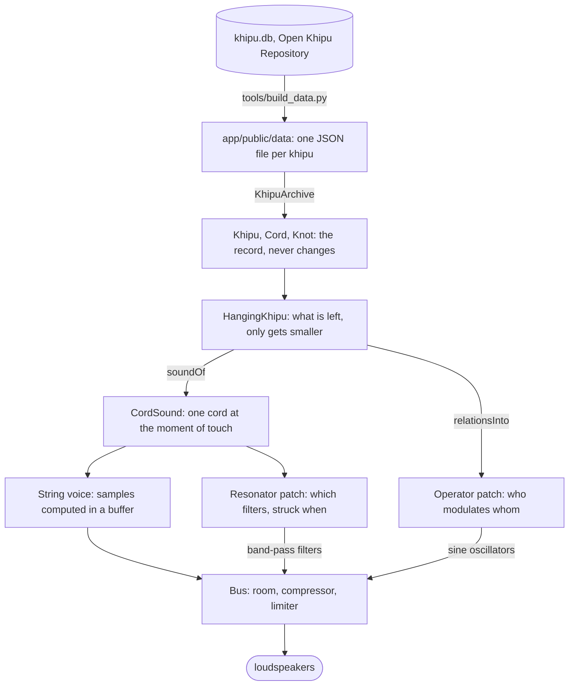
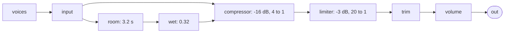
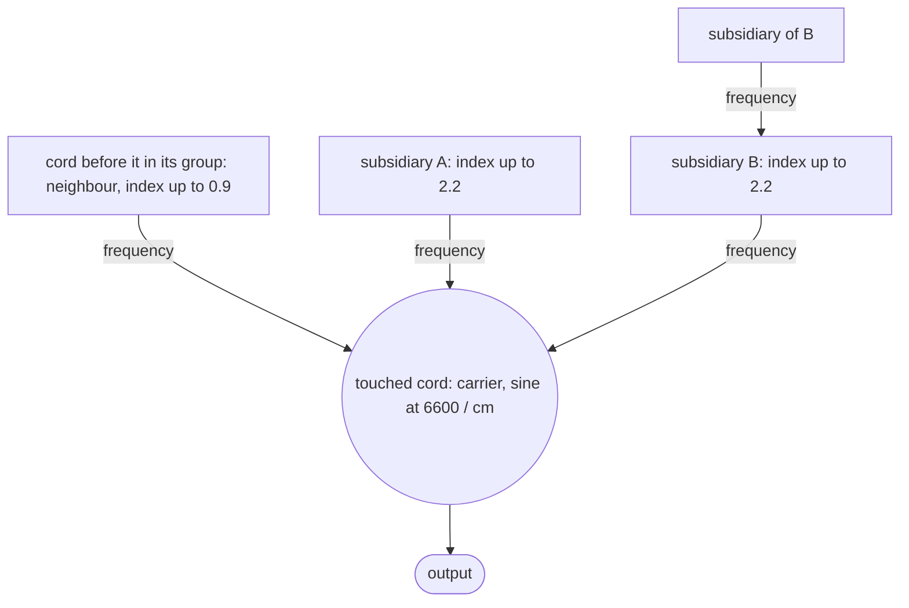

# How *Just Ends* sounds

**Each sound algorithm in the prototype, and what it reads from the khipu database**

Nothing in the prototype is sampled and no musical scale is applied. Every sound is computed, at the moment a cord is touched, from that cord's row in the Open Khipu Repository (`khipu.db`) and from what is still hanging of it.

There are three voices. Each takes a different layer of the same tables to be the sound:

| Voice | Layer of the database | Columns that decide the pitch | Algorithm |
|---|---|---|---|
| **String** | what was *measured* | `cord.CORD_LENGTH`, `knot_cluster.START_POS` | A plucked-string model (Karplus-Strong), with each knot as a partial |
| **Operator** | how the rows are *related* | `cord.PENDANT_FROM`, `cord_cluster.ORDINAL`, then the proportions between knot values | Frequency modulation between sine oscillators (Tone.js) |
| **Resonator** | what the knots are *read as* | `knot.knot_value_type` | A struck bank of resonant band-pass filters (Tone.js) |

They share everything else: how a sound ends (the termination code), how long it rings (the colour), what is heard where the archive is blank (breath), where it sits (position), and what wear does to it.

> [!IMPORTANT]
> I could not listen to any of this. What is stated below about the algorithms is read from the code and checked by unit tests. Where it says "measured", the sound was rendered offline in Chrome and the result analysed (section 9). Counts over the archive were made by running the project's own code over all 619 khipus. How it *sounds*, and whether the balances are right, has to be judged by ear.

---

## 1. From the database to a sound

### The path of a row



Two objects are kept apart all the way down. The **record** (`Khipu`) is the database row and never changes. **What is left** (`HangingKhipu`) starts equal to the record and only loses things. Every voice is computed from what is left, so the sound of a cord changes as it is worn, while the ledger beside it goes on showing the row.

### Which columns are heard

`tools/build_data.py` reads 8 of the database's 26 tables. These are the columns that reach the sound.

| In `khipu.db` | In the app | Heard as |
|---|---|---|
| `cord.CORD_LENGTH` (cm) | `cord.length` | **Pitch** of the string voice and of the operator voice's carrier. Also places each knot on the cord, as a fraction of its length |
| `ascher_cord_color.COLOR_CD_1` of the cord's first colour span, looked up in `ascher_color_dc` (`R_DEC`, `G_DEC`, `B_DEC`) | `cord.color`, `cord.lightness` | **Ring time** in every voice. Brightness in the string voice. The pitch of the resonator's tap |
| `cord.TERMINATION` | `cord.termination` | **How the sound ends**, in every voice |
| `cord.PENDANT_FROM` | `cord.parent`, `cord.children` | Operator voice: a subsidiary **modulates** the cord it hangs from. Every voice: touching a cord also touches its subsidiaries |
| `cord.CLUSTER_ID` → `cord_cluster.ORDINAL` | `cord.group` | Operator voice: the cord before a cord in the same group modulates it |
| `cord_cluster.START_POSITION`, `END_POSITION`, `NUM_CORDS`, with `cord.CLUSTER_ORDINAL` | `cord.position` (cords on the main cord) | **Time** during a reading, and **left to right** in the loudspeakers |
| `knot_cluster.START_POS` (cm from the top of the cord) | `knot.position` | String voice: which **partial** the knot sounds. Every voice: when in the sound the knot is heard |
| `knot.TYPE_CODE` of the first knot of the cluster | `knot.type` | Single knots: one event each. Long knots: a roll. Figure-eight knots: beating |
| number of `knot` rows in the cluster | `knot.count` | How many events |
| sum of `knot.knot_value_type` over the cluster | `knot.value` | Resonator voice: the **pitch** of the resonance. Operator voice: the **proportion** between two cords and the depth of modulation |
| `knot.DIRECTION` of the first knot of the cluster | `knot.direction` | S to the left, Z to the right |
| `primary_cord.PCORD_LENGTH` | `khipu.primary.length` | The pitch of the **hum** under everything |

### Four things to know before trusting the result

- **The position of a cord along the main cord is its group's, not its own.** The database records where each *group* of cords starts and ends. `build_data.py` spaces the cords of a group evenly between those two points: 32,869 of the 39,024 cords on a main cord (84%) are placed that way. A further 3,661 have no usable position and are given an estimated one (in 25 khipus fewer than half the pendants can be placed, and all of them are spread evenly). Panning, the order of a reading and "the cord before it" all inherit this.
- **`knot_value_type` is already an interpretation.** It is the decimal reading of the knot: 10, 100 or 1000 for a single knot according to its place on the cord (99.7% of single knots), the number of turns for a long knot (2 to 9 for 98.3% of them), 1 for a figure-eight (98.9%). The database stores it for every knot of every khipu. The database's own total per cluster (`knot_cluster.TOTAL_VALUE`) is empty in every row, so the app adds the knots up itself.
- **A cluster's type and direction are those of its first knot.** 89 clusters hold knots of more than one type and 144 of more than one direction.
- **Which cords are top cords is uncertain.** The app takes the sign of `cord.CORD_LEVEL` (154 top cords in 25 khipus). The database also has a classification column that marks 249 cords in 36 khipus. The 95 it marks whose level is positive hang down in the app and sound as ordinary pendants. I could not establish which encoding is right.

### Columns that are shown but not heard

Twist (`cord.TWIST`), attachment (`ATTACHMENT_TYPE`), fibre (`FIBER`), the second colour of a two-colour cord, and all notes are in the ledger and have no effect on the sound. Not carried into the app at all: cord thickness (recorded for one cord in ten), twist angle, colour changes further along a cord (1,959 cords have more than one colour span), third colours, the orientation of a knot's axis, the turns column of long knots, the database's classification of cords and groups, and the canutos.

### How much of it is there

Counts over the whole archive: 619 khipus, 54,403 cords, 59,920 clusters of knots, 110,151 knots.

| Field | Recorded | Not recorded | What the blank does to the sound |
|---|---|---|---|
| Cord length | 52,125 | 2,278 (the database writes 0) | No pitch in the string and operator voices: breath only |
| Colour | 52,839 | 1,564 | The ring time of a mid-brown cord is assumed (lightness 0.4, 1.54 s). No breath |
| Termination | 52,694 | 1,709 | The cord is "barely there": a third of the level, half the ring, under breath |
| Knot position (per cluster) | 59,831 | 89 | String voice: no partial, only a tick. Every voice: the knot sounds at an arbitrary moment |
| Knot direction (per cluster) | 52,491 | 7,429 | The knot sits in the middle. In the string voice it is partly noise |
| Knot value (per cluster) | 59,721 | 199 are worth 0 | Resonator voice: nothing rings for that cluster |
| Knots on the cord | 37,082 cords carry knots | 17,321 cords carry none | Resonator voice: nothing rings, only the tap |
| Position on the main cord | 35,363 (from the group) | 3,661 estimated | None: the estimate is used |
| Group | 50,487 | 3,916 | Operator voice: no neighbour to modulate the cord |
| Main cord length | 584 khipus | 35 | The hum is at a default 55 Hz |

---

## 2. One cord, three readings

A real row makes the rest easier to follow. This is **KH0279, cord 14**, the cord used in the README's library example.

| In the row | |
|---|---|
| Kind | a pendant, in the third group, 5.5 cm along the main cord |
| Length | 43.5 cm |
| Colour | `AB`, light brown (lightness 0.44) |
| Termination | `K`, knotted |
| Knots | 2 single knots at 8.5 cm, worth 20, direction Z. One long knot of 8 turns at 19 cm, worth 8, direction S |
| Before it in its group | cord 13: 49 cm, no knots |
| Hanging from it | cord 240: 32 cm, worth 46 (four single knots worth 40, and a long knot of 6) |

**String voice** (the row as measurements). The length gives the pitch: 6600 / 43.5 = **151.7 Hz**, and light brown rings for 1.6 s. Each knot is a partial of that string. The knots at 8.5 cm sound 43.5 / 8.5 = 5.12 times the cord, **776 Hz**: two pings 75 ms apart, starting 0.14 s after the touch, to the right (Z). The long knot at 19 cm sounds 2.29 times the cord, **347 Hz**: a roll of eight grains from 0.25 s, to the left (S). The values 20 and 8 play almost no part, and cords 13 and 240 none.

**Operator voice** (the row as relationships). The cord is a sine tone at the same 151.7 Hz, and two other cords bend it:

| Modulator | Proportion | Frequency | Index |
|---|---|---|---|
| cord 13, its neighbour | it has no knots, so lengths: 49 / 43.5 = 1.13 | 170.9 Hz | 0.9 × 0.4 = **0.36** |
| cord 240, its subsidiary | values: 46 / 28 = 1.64 | 249.3 Hz | 2.2 × (0.4 + 0.6 × 46 / 74) = **1.70** |

Neither proportion is a whole number, so the partials are not harmonics of the cord: the tone is bell-like at the touch and settles towards a plainer one as the indices fall to a quarter (0.09 and 0.43).

**Resonator voice** (the row as numbers). The length is ignored. The 20 is a filter at **271.0 Hz**, struck twice (at 0.14 and 0.21 s). The 8 is a filter at **205.7 Hz**, struck in a roll of eight (from 0.25 to 0.48 s). Both ring for 1.6 s. Under them is the dry tap of the strike at 450 Hz.

The ledger shows these same lines under the row, for whichever voice is chosen:

```
string · 152 Hz · rings 1.6 s
  knot at 8.5 cm · ×5.12 of the cord · 776 Hz · 2 pings
  knot at 19 cm · ×2.29 of the cord · 347 Hz · a roll of 8

operator · sine 152 Hz, modulated by
  neighbour cord 13 · ×1.13 of lengths · 171 Hz · depth 0.36
  subsidiary cord 240 · ×1.64 of values · 249 Hz · depth 1.7

resonator · rings at
  20 · 271 Hz · 2 strikes
  8 · 206 Hz · 8 strikes
```

**The same cord as it wears.** Touched again and again at the default wear (0.45), in one run:

| Touch | What is left | String | Operator | Resonator |
|---|---|---|---|---|
| 1 | both knots | 152 Hz with partials at 776 and 347 | subsidiary ×1.64, depth 1.70 | 271 and 206 Hz |
| 2 | the knots worth 20 have fallen | 152 Hz with one partial, 347 | the pair is now 46 to 8: ×5.75, depth 2.00 | 206 Hz |
| 3 to 5 | the subsidiary has lost its 40 | the same | 8 to 6: ×1.33, depth 1.45 | 206 Hz |
| 6 | the last knot has fallen; the cord begins to fray | 152 Hz and breath | no number left: lengths, ×1.36, depth 2.20 | only the tap |
| 7, 8 | fraying further | more breath | the same | only the tap |
| 9 | the cord falls, and its subsidiary with it | silence | silence | silence |

The string voice loses partials, the resonator voice loses notes of its chord, and the operator voice changes timbre at each loss, because every loss changes a proportion.

---

## 3. What every voice shares

### The cord at the moment of touch

`soundOf(hanging, cord)` gathers what can be heard of one cord *as it is now*:

| Field | From | Now |
|---|---|---|
| `length` | `CORD_LENGTH` | Shorter if the cord has parted |
| `lightness` | the colour's RGB | Unchanged |
| `termination` | `TERMINATION` | Becomes "broken" once the cord has parted |
| `knots` | the cord's knot clusters | Only those still tied |
| `pan` | position along the main cord | Unchanged |
| `integrity` | 1 | Falls with each touch once the knots are gone |

### Pitch from length

```
f = 6600 / length_cm        moved by octaves into 65 to 1568 Hz
```

A 30 cm cord is 220 Hz, a 60 cm cord 110 Hz, a 20 cm cord 330 Hz. Pitch inversely proportional to length is the behaviour of a string at fixed tension. The constant 6600 is ours. No tuning system is applied: the intervals of a khipu are the ratios of its cord lengths. This rule gives the pitch of the string voice and the carrier of the operator voice. The resonator voice does not use it.

**What the archive's lengths sound like.** The 52,125 measured cords run from 0.5 to 415 cm, with a median of 32 cm, and half of them lie between 23 and 40 cm.

| | 65–130 Hz | 130–260 Hz | 260–520 Hz | 520–1040 Hz | 1040–1568 Hz |
|---|---|---|---|---|---|
| Cords | 4,276 | 31,814 | 10,869 | 3,880 | 1,286 |
| Share | 8.2% | 61.0% | 20.9% | 7.4% | 2.5% |

- The median pitch is 206 Hz. Six cords in ten fall in the single octave from 130 to 260 Hz.
- Lengths were written down to the centimetre or half centimetre, so there are only 262 distinct lengths and **240 distinct pitches** in the whole archive.
- 1,976 cords (3.8%) are moved by octaves: 1,866 shorter than 4.2 cm are lowered, 110 longer than 101.5 cm are raised. A 2 cm stub sounds 825 Hz, not 3300.
- **The commonest single pitch, 825 Hz (1,333 cords), is mostly made by this folding.** Four in five of those cords are stubs of 0.5 to 4 cm brought down onto the pitch of an 8 cm cord, and nine in ten cords that short are recorded as broken. In the string and operator voices the archive's damage has a note of its own.

### Colour: how long it rings

```
lightness = (0.2126 R + 0.7152 G + 0.0722 B) / 255        from the colour chart's RGB
T60       = 0.9 + 1.6 × lightness   seconds                 time to fall by 60 dB
```

This is an analogy and nothing more: pale, undyed cord is treated as the more resonant material. Three colours carry most of the archive, so three ring times do too:

| Colour | Cords | Lightness | Rings |
|---|---|---|---|
| `W` white | 13,852 (26%) | 0.96 | 2.43 s |
| `AB` light brown | 9,363 (18%) | 0.44 | 1.61 s |
| `MB` moderate brown | 7,756 (15%) | 0.26 | 1.31 s |
| `KB` dark brown | 3,562 (7%) | 0.11 | 1.08 s |
| the darkest colour used | | 0.06 | 1.00 s |
| not recorded | 1,564 | taken as 0.4 | 1.54 s |

All 64 colours of the chart occur. Only the first colour of a cord is heard: 12,764 cords have a second (mottled or barber-pole), which is drawn and not sounded.

### The termination: how it ends

Each termination code has a duration and a way of ending. The definitions are the database's own (`termination_dc`).

| Code | The archive's words | Cords | Lasts | In the sound |
|---|---|---|---|---|
| `K` knotted | "cord ends with a knot near the bottom" | 37,692 | 2.4 s | Rings out |
| `B` broken | "cord has been broken" | 9,392 | 1.5 s | Cut off between 0.54 and 0.84 s over 3 ms, with a crack of noise |
| `U` unfinished | "not knotted; not broken; not cut... just ends" | 3,000 | 1.7 s | Hardly decays at all (9 s ring), then stops at 1.05 s over 20 ms. No crack |
| `R` ravelled | "plies are coming apart" | 2,190 | 2.6 s | Four strands instead of one, at 1, 1.011, 0.985 and 1.027 times the pitch, each dying a little sooner than the last: they drift apart |
| not recorded | | 1,709 | 1.4 s | A third of the level, half the ring, under 1.2 s of breath |
| `TT` canutito | "end of cord is wrapped with colored thread" | 359 | 0.75 s | Damped: rings for 0.16 s |
| `D` doubled | "end of cord is doubled over" | 54 | 2.6 s | A second strand an octave below |
| `C` cut | "cord has been cut (sharper end than broken)" | 7 | 0.9 s | Cut off at 0.22 s over 0.4 ms, with a smaller crack |

In the string voice a "strand" is a string. In the operator voice it is a sine oscillator. In the resonator voice every resonance is split into the same strands. A sound that is cut off takes with it whatever would have come later: on a broken cord, the last strikes of a long roll near the bottom are not heard.

### What was not recorded

Breath is band-limited noise that swells quickly and fades slowly (its envelope is `sin(π t^0.6)` over its length). It stands for two blanks, and for wear:

| | Breath |
|---|---|
| Length not recorded | String and operator voices: the whole sound is 1.1 s of breath centred between 500 and 1400 Hz, with no pitch. Resonator voice: no breath for this; the knots ring as usual |
| Termination not recorded | Every voice: 1.2 s of breath, centred an octave above the cord, over a faint cord |
| The cord is worn | Every voice: up to 0.9 s centred at 1200 Hz, at a level of 0.35 × (1 − integrity) |

Other blanks are not breath. An unrecorded colour is given a middle ring time. An unrecorded knot direction puts the knot in the centre (and, in the string voice only, replaces 45% of its ping with noise). An unrecorded knot position gives the knot an arbitrary moment (and, in the string voice, makes it a tick of noise).

Of the 2,278 cords with no length, 1,223 have no termination either and only 39 have knots. In 9 khipus (806 cords) no cord has a length at all: in the string and operator voices those khipus are breath from end to end.

### Wear

The wear rule is the one invented part of the model (`HangingKhipu.wear`). With the wear slider at *w* (0 to 1), each touch:

1. lets each cluster of knots still on the cord go, with probability *w* / 2;
2. once no knots are left, lowers the cord's integrity by between 0.4 *w* and *w*;
3. when integrity reaches zero, either parts the cord (it keeps 30 to 75% of its length, and the subsidiaries tied below the break fall), or drops it whole with everything hanging from it.

What this does to the sound, in every voice:

- A knot that has fallen is no longer heard, and its value no longer counts.
- A cord with no knots left carries more breath at each touch.
- A cord that has parted is shorter, so in the string and operator voices it sounds *higher*, and it now ends as a broken cord does.
- A cord that has fallen is silent.

### Where and when

- **Left to right:** `pan = 1.4 × (position / width) − 0.7`, so cords lie between −0.7 and 0.7.
- **Reading:** the hand crosses the main cord in 0.22 s per pendant, but never in less than 25 s or more than 150 s, touching each pendant as it passes, then rests 1.4 s and starts again.
- **Subsidiaries:** touching a cord touches each of its subsidiaries after it, 90 ms apart and at 0.6 of the level, and theirs in turn. On each cord only the first eight are sounded; all of them are worn. (83 cords have more than eight.)
- **Limits:** one stroke of the hand sounds at most 13 cords, and a cord not again within 0.12 s. At most 30 string, 16 operator or 20 resonator sounds are heard at once; a touch beyond that still wears the cord but is silent.

### The bus



The room is a convolution with a computed impulse: 3.2 s of noise that gets darker and quieter as it goes (amplitude `(1 − t)^3.2`). It is meant as a storeroom, not a hall. The limiter was added after measurement showed the output going 2 dB over full scale when the largest allowed number of cords sounded in the same instant. The trim cancels the fixed gain that a Web Audio compressor adds, so that below its threshold the limiter changes nothing. No node is asked for a frequency above 0.45 of the output's sample rate, so a slow output (a telephone headset at 8 or 16 kHz) lowers a few sounds and breaks nothing.

---

## 4. String voice: the row as measurements

*[`stringVoice.ts`](../app/src/audio/stringVoice.ts). A pure function from a cord to stereo samples; nothing in it uses Web Audio. It is a line-for-line port of the first prototype's synthesis and gives the same samples.*

The cord is treated as a string of its measured length, plucked. Its knots are treated as fingers resting on that string.

### The cord: a Karplus-Strong string

1. A delay line of `N = round(sample_rate / f)` samples is filled with low-passed noise, its mean removed, and scaled to a peak of 1. This is the pluck.
2. The line is read round and round. Each sample that comes out is put back as

   ```
   line[i] = g × ((1 − s) × line[i] + s × line[i + 1])
   ```

   an average of two neighbours, which dulls the string a little on every pass, times a loss `g = 10^(−3 / (T60 × f))`.

| From the row | Sets |
|---|---|
| Length | `N`: the length of the delay line, so the pitch |
| Colour (lightness) | `T60`, in `g`: how long it rings |
| Colour (lightness) | `s`, from 0.41 (black) to 0.16 (white): how fast the high partials die |
| Colour (lightness) | How dull the pluck is: the noise is low-passed harder for dark cords |

The termination chooses the variant, as in the table of section 3: one string, four detuned strings (ravelled), a string and its lower octave (doubled), a damped string (canutito), a string that barely decays and is then stopped (unfinished).

> [!NOTE]
> The delay line is a whole number of samples, so the pitch of the string voice is close to `6600 / cm` but not exactly it. Measured at 48 kHz: within 10 cents up to 1100 Hz, and as much as 39 cents sharp at 1318 Hz. At 44.1 kHz the worst case is 45 cents. The operator voice has no such error: its carrier is exactly `6600 / cm`.

### The knots: partials on the string

For a cluster of knots at distance *p* from the top of a cord of length *L*:

```
ratio  = L / p          kept between 1 and 24
f_knot = f × ratio      lowered by octaves until it is under 4200 Hz
```

A knot half-way down sounds the octave above the cord, a knot a third of the way down the twelfth, as a finger touching a string at those points would. A knot at 8.5 cm on a 43.5 cm cord sounds 5.12 times the cord's pitch, which is not a harmonic: the ratios are whatever the measurements are. The rule is one exported function, `knotPartial`, which the ledger also uses, so what the ledger prints is what sounds.

Each knot is a short sine "ping" at that frequency with a 3 ms attack and an exponential decay.

| From the row | In the sound |
|---|---|
| `knot_cluster.START_POS` | The ratio above. And the time: the knot sounds `0.05 + 0.45 × p / L` seconds after the touch, so the cord is read from the top down in half a second |
| Type `S` (single), count *n* | *n* pings (9 at most), 75 ms apart |
| Value of one knot of the cluster (10, 100, 1000) | How slowly each ping dies: a time constant of 0.32 s for tens, 0.42 s for hundreds, 0.52 s for thousands |
| Type `L` (long), *n* turns | A roll of *n* short grains (2 to 11) 34 ms apart, getting louder, then one longer ping |
| Type `E` (figure-eight) | Two pings at once, at `f_knot` and `1.012 × f_knot + 2 Hz`: they beat |
| Direction `S` or `Z` | Left (−0.75) or right (+0.75) |
| Direction not recorded | Centre, and 45% of the ping is replaced by noise |
| Position or cord length not recorded | No pitch can be given: the knot is a tick of noise, at a random moment if it has no position |

**In the archive.** Of the 59,920 clusters, 43.7% are long knots, 41.4% single knots and 13.8% figure-eights. 124 have no partial and are ticks. For 118 the ratio is held at 24 (a knot in the top 4% of its cord), and 403 partials are lowered by octaves to stay under 4200 Hz. 61 clusters are recorded further down the cord than the cord is long; they sound the cord's own pitch. 7,429 have no direction and carry noise.

### The mix

The cord and its knots are added, the ending is applied to the whole (a broken cord takes its knots with it), the last 30 ms are faded, and the buffer is scaled so that its peak is 0.5 or a little less. A buffer is kept and reused while its cord has not changed, and all are dropped when the khipu is tied again.

**What this voice ignores.** The value of a knot hardly matters (only in how long a ping lasts), and the relations between cords not at all. It sounds what was measured on one cord.

---

## 5. Operator voice: the row as relationships

*Mapping: [`operatorPatch.ts`](../app/src/audio/operatorPatch.ts) (a pure function). Sound: [`OperatorVoice.ts`](../app/src/audio/OperatorVoice.ts), on Tone.js.*

Every cord is a sine-wave oscillator, an *operator* in the sense of FM synthesis. The cord that is touched is the **carrier**, at the pitch of its length, and it is the only oscillator of the patch that is connected to the output. The cords related to it are **modulators**: they are not heard in that tone, they change the carrier's frequency many times a second, and that is heard as timbre.

This is the only voice in which a cord cannot be sounded apart from the cords around it. It reads the two relations that the database's own structure encodes: the foreign key `cord.PENDANT_FROM` (this cord hangs from that one) and the grouping table `cord_cluster` (these cords hang together). The relations are between cords of one khipu; nothing relates one khipu to another.

### Who modulates whom



| Relation in the database | In the patch |
|---|---|
| A cord whose `PENDANT_FROM` is this cord (a subsidiary) | Modulates this cord |
| Subsidiaries of that subsidiary | Modulate *it*, and so on: a stack, three levels deep at most |
| The cord hanging just before this one in the same `cord_cluster` | Modulates this cord too, more weakly. Only for the touched cord: a modulator's own neighbours are left out |
| More relations than six | The first six are used, nearest level first, so that one deep chain cannot use up what the cord's other subsidiaries need |
| A cord that has fallen | Modulates nothing |
| The touched cord has no recorded length | It has no carrier, so there is nothing to modulate: only breath |

**In the archive.** 15,379 cords hang from another cord, and 8,985 cords have at least one subsidiary (most have one; the most on one cord is 30; the deepest chain is six cords). 35,563 cords have a cord before them in their group. Touching each cord of the archive once, before anything is worn:

| Operators in the patch | 0 | 1 | 2 | 3 | 4 | 5 | 6 |
|---|---|---|---|---|---|---|---|
| Cords | 18,048 | 28,801 | 4,853 | 1,258 | 505 | 277 | 661 |
| Share | 33.2% | 52.9% | 8.9% | 2.3% | 0.9% | 0.5% | 1.2% |

- **Two cords in three (36,355) are modulated.** 15,770 are bare sine tones, and 2,278 have no pitch.
- More than half of all patches are one carrier and one modulator, and that modulator is usually the neighbour: of the 49,652 modulators, 69% are neighbours and 31% subsidiaries.
- Stacks are rare: 913 patches reach a second level and 84 a third. 463 patches are offered more than six modulators and are cut.
- 1,500 cords with no recorded length do have a neighbour or subsidiaries in the record. Their relations are not heard in this voice.
- 2,421 subsidiaries name a group that belongs to another khipu (a fault in the source data). The build tool rejects it, so they have no neighbour.

### Tuning: the proportion between two cords

```
proportion  = larger value / smaller value        of the two cords' knot values, as they are now
f_modulator = f_target × proportion               lowered by octaves until it is under 6000 Hz
```

where "target" is the cord being modulated. A subsidiary carrying 60 on a cord carrying 20 modulates at three times that cord's frequency; so does one carrying 20 on a cord carrying 60. If either cord carries no number (no knots left, or knots the archive gives no value), the proportion of their two *lengths* is used. If that cannot be had either, the proportion is 1.

What a proportion sounds like follows from how FM works. A carrier at *f* modulated at *r × f* has partials at *f × |1 ± k r|* for *k* = 1, 2, 3...

| Proportion *r* | Partials | Character |
|---|---|---|
| 1 | every harmonic of the cord | Full, like a bowed or reed tone |
| 2 | odd harmonics only | Hollow |
| 3, 4, 5... | harmonics with regular gaps | Harmonic, thinner as *r* grows |
| not a whole number (1.64, 2.8...) | not harmonics of the cord | Bell, metal, clang |

So whole-number relations between the numbers on two cords are heard as a pitched, harmonic tone, and any other relation as an inharmonic one. Nothing is decoded: the voice does not look for sums or for any arithmetic between cords. (In the archive only 531 of the 8,985 cords with subsidiaries have subsidiaries that add up to them.)

**Lowering.** A modulator that would sound above 6 kHz is lowered by octaves, and each octave halves the proportion that actually sounds. A whole proportion lowered by *n* octaves still gives a harmonic tone, but on a fundamental up to *n* octaves below the cord: ×5 lowered once is ×2.5, whose partials are all multiples of half the cord's frequency. The ledger prints both figures (`×5 of values, 1 octave down to ×2.5`).

**In the archive.**

| | Proportion of values | Proportion of lengths | No proportion |
|---|---|---|---|
| Modulators | 29,339 (59%) | 19,748 (40%) | 565 (1%) |
| Within 0.5% of a whole number | **44%** | **11%** | |
| Median proportion | 2.31 | 1.24 | 1 |

- The numbers knotted on related cords stand in whole-number proportions four times as often as their lengths do. The commonest proportions of values are 1 (3,776 modulators), 2 (2,147), 3 (1,014), 1.5 (842), 4 (708) and 5 (636). This is a fact about the decimal readings in the database; the voice makes it audible as the difference between a harmonic and an inharmonic tone.
- One first-level modulator in ten has a proportion of exactly 1: two cords carrying the same number, modulating at the carrier's own frequency.
- 3,709 modulators (7.5%) are lowered by octaves, most by one or two. Of the 3,416 at the first level, 1,238 had a whole proportion that is no longer whole.

### Depth: how hard a cord is bent

```
index = K × depth × (0.4 + 0.6 × share) × integrity

K         2.2 for a subsidiary, 0.9 for a neighbour
depth     the slider, 0 to 2 (1 by default)
share     modulator's value / (modulator's value + target's value); 0 if the modulator carries no number
integrity the modulator's: 1 when sound, falling as it wears
```

The index is the modulation index of FM: the peak change of the carrier's phase, in radians. A subsidiary that carries most of what the pair adds up to bends its parent hard, one that carries nothing bends it lightly. The index is also held down so that the carrier's partials stay under 18 kHz (this touches 59 modulators in the archive), and a modulator whose index would be under 0.01 is left out. At depth 1 the archive's indices run from 0.36 to 2.2, with a median of 0.58 for neighbours and 1.1 for subsidiaries.

### The sound

```
carrier(t) = A(t) × sin( 2π f t + Σ I_m(t) × sin(2π f_m t) )
I_m(t)     = index_m × (0.25 + 0.75 × e^(−t / 0.35 s))
A(t)       = 4 ms attack, then a fall of 60 dB in the ring time given by the colour
```

In the Web Audio graph each modulator is a Tone.js sine oscillator whose output, multiplied by `index × f_modulator` (a frequency deviation in hertz), is added to the frequency input of the oscillator it modulates. Stacks are built the same way.

- The index starts at its full value and settles to a quarter of it with a time constant of 0.35 s. **A cord sounds its relations first and then, more plainly, itself.**
- The termination works as in the other voices. A ravelled cord is four sine tones, of which only the first is modulated. A broken, cut or unfinished cord is gated off.
- Touching a cord also touches its subsidiaries (section 3), so a subsidiary is first heard *through* its parent, as timbre, and 90 ms later as a quieter tone of its own, modulated by its own relations.

### What wear does here

Every quantity above is read from what is still hanging, at each touch.

| What happens to the khipu | What happens to the sound |
|---|---|
| A knot falls from the cord or from one of its modulators | The proportion changes, so the partials move. The share changes, so the depth changes |
| The cord or a modulator loses its last knot | The proportion falls back to the ratio of lengths |
| A modulator frays | It modulates less |
| A modulator falls | It is gone from the patch |
| All of them have fallen | The cord is a bare sine tone |

As a khipu comes apart, its cords lose their relations one by one and the sound becomes simpler: what is heard to go is relation, not loudness.

---

## 6. Resonator voice: the row as numbers

*Mapping: [`resonatorPatch.ts`](../app/src/audio/resonatorPatch.ts) (a pure function). Sound: [`ResonatorVoice.ts`](../app/src/audio/ResonatorVoice.ts), on Tone.js.*

The cord is struck, and what rings is a bank of resonant filters, one for each cluster of knots still on it, tuned by the cluster's value. The length of the cord plays no part in the pitch. This voice takes the database's `knot_value_type` column at its word.

### The scale: a slide rule

```
f = 110 Hz × 2^(log10 value)
```

The digits 1 to 9 are spread across one octave by their logarithm, and each power of ten is one octave higher.

| | 1 | 2 | 3 | 4 | 5 | 6 | 7 | 8 | 9 |
|---|---|---|---|---|---|---|---|---|---|
| units (Hz) | 110.0 | 135.5 | 153.1 | 167.0 | 178.6 | 188.6 | 197.6 | 205.7 | 213.1 |
| tens (Hz) | 220.0 | 271.0 | 306.2 | 333.9 | 357.1 | 377.3 | 395.2 | 411.4 | 426.3 |
| hundreds (Hz) | 440.0 | 542.1 | 612.5 | 667.9 | 714.3 | 754.6 | 790.4 | 822.8 | 852.5 |
| cents above 1 | 0 | 361 | 573 | 722 | 839 | 934 | 1014 | 1084 | 1145 |

3, 30 and 300 are the same note in three octaves, in the way the same knots count different amounts by their place on the cord. A cord reading 354 is the chord 300 + 50 + 4 (612, 357 and 167 Hz). Equal numbers sound the same wherever they are, in any khipu, on a cord of any length or colour. The base of 110 Hz and the octave per decade are ours.

**In the archive.** 36,987 cords (68%) carry a number and ring; 17,416 only tap (17,321 have no knots, 95 have knots the database gives no value). The values are small: 58% of clusters are worth 1 to 9, 30% are worth 10 to 99, and 0.2% are worth 10,000 or more.

| Value | 1 | 10 | 2 | 4 | 3 | 5 | 20 | 100 |
|---|---|---|---|---|---|---|---|---|
| Share of all filters | 24.0% | 9.3% | 8.5% | 6.4% | 6.3% | 5.7% | 4.8% | 3.2% |
| Hz | 110.0 | 220.0 | 135.5 | 167.0 | 153.1 | 178.6 | 271.0 | 440.0 |

- **A quarter of everything this voice rings is the value 1**, at 110 Hz and its beating partner at 113.3 Hz: 98% of the clusters worth 1 are figure-eight knots, and a figure-eight rings two filters.
- Half of all filters lie between 135 and 271 Hz, with a median of 178.6 Hz (the value 5). The archive in this voice is low and narrow, and 220 Hz (ten) is its second commonest note.
- The largest value, 300,000 (three single knots of 100,000 on the first cord of KH0426), rings at 4900 Hz. Nothing reaches the scale's limits of 40 and 9000 Hz.
- 120 clusters are not a digit times a power of ten (11, 12 and 13 are the commonest: long knots of more than nine turns). They fall between the notes of the table.

### From knots to strikes

| From the row | In the patch |
|---|---|
| Value of the cluster (`knot_value_type` summed) | The frequency of its resonance |
| Type `S`, count *n* | *n* strikes (9 at most), 75 ms apart |
| Type `L`, *n* turns | A roll of *n* strikes (2 to 11) 34 ms apart, rising in level to the last |
| Type `E` (figure-eight) | Two resonances, at *f* and at `1.012 f + 2 Hz`, struck once: at the value 1 they beat 3.3 times a second |
| `knot_cluster.START_POS` | When it is struck: `0.05 + 0.45 × p / L` seconds after the touch. The cord is read from the top. With no position, or on a cord with no length, at an arbitrary moment |
| Direction `S` or `Z` | 0.4 to the left or right of where the cord hangs |
| Colour | How long the resonances ring, times the **ring** slider (a multiplier, 0.2 to 3) |
| Termination | As everywhere. A ravelled cord rings each number as four close resonances, a doubled cord as two an octave apart |
| A strike that would fall after a broken, cut or unfinished cord has stopped | It is not struck, and not counted in the ledger |
| No knots, or none left, or none with a value | Nothing rings. Only the tap of the strike is heard |

A cord in the archive is struck 4 times at the median when it rings, and 46 times at the most (KH0289, cord 78).

### Twelve filters, shared out by number

One touch rings at most twelve filters. A ravelled cord asks for four per number and a figure-eight for two, so a cord can ask for many more (the most in the archive is 40, for seven numbers on a ravelled cord). The filters are shared out a round at a time: **every number gets its first filter before any number gets a second.** What is thinned is the strands of a ravelled cord, never the numbers on it.

In the archive 332 cords reach the limit, and on 84 of them some strands are thinned. No cord carries more than seven numbers, so no number is ever left out. (An earlier version filled the twelve from the top of the cord and stopped: 89 cords lost whole numbers, usually their units. An independent review found it, and the rule was changed.) If a cord ever did carry more than twelve numbers, the ledger would mark the rest `beyond the limit`.

### The filters

Each resonance is a real two-pole band-pass filter (a Web Audio biquad, through Tone.js), and the strike is a real signal sent into it.

```
τ = T60 / 6.91                       time for the ring to fall by a factor of e
Q = τ × sample_rate × sin(ω) / 2     ω = 2π f / sample_rate
```

A band-pass struck by a very short pulse rings at its centre frequency and dies away at a rate set by its Q, so the ring time asked for is turned into a Q. For a 2.18 s ring at 271 Hz the Q is 268.

- **The strike** is a smooth pulse a quarter of a millisecond long. It has less energy at high frequencies than at low ones; the gain after each filter makes up for that, so that a resonance at 800 Hz is as loud as one at 150 Hz.
- **The tap** is a 50 ms burst of band-passed noise, lower for dark cords (220 Hz) than for pale ones (740 Hz). It is what a strike sounds like with nothing to ring, and it is all a knotless cord has.
- A browser stops computing a filter soon after its input goes silent, which cut these rings off after a fifth of their length. A constant too small to hear is fed to each filter to keep it running (section 9).

### What wear does here

Each knot cluster that falls takes its resonance with it: the chord thins, one number at a time. A cord that has lost all its knots only taps. Since the pitch never came from the cord, a cord that parts does not change pitch in this voice.

---

## 7. The sounds that are not cords

| Sound | When | From the row | How it is made |
|---|---|---|---|
| **Hum** | As long as a khipu with cords is on stage | `primary_cord.PCORD_LENGTH` | `6600 / cm` again, but moved by octaves into 42 to 84 Hz. A triangle wave with a sine a fifth above it, low-passed at 320 Hz, swelling very slowly. 55 Hz if the main cord was never measured |
| **Grain** | Each fragment of a fallen knot landing on the bed | the cord's lightness | 30 ms of narrow-band noise between 1800 and 6800 Hz, brighter for pale cords, placed where it lands |
| **Snap** | A cord parting or coming away | where the cord hangs | 90 ms of band-passed noise around 900 to 1600 Hz |
| **Crack** | Inside the sound of a broken or cut cord | `TERMINATION` | 40 ms of low-passed noise with a 6 ms decay |

The hum in the archive: 578 khipus hum at the pitch of a measured main cord, 34 at the default, and the 7 khipus with no cords are silent. Main cords run from 1.4 to 513.5 cm (median 47 cm), so all but 96 are moved by octaves; the hums lie between 42.0 and 83.5 Hz with a median of 56.9 Hz.

---

## 8. What comes from the archive, and what is ours

The khipus are undeciphered and none of this decodes them. Every mapping is a choice. The table separates what the database supplies from the constants and analogies that were chosen.

| From the archive | Our choice |
|---|---|
| Cord length in cm | That length is pitch at all; `6600 / cm`; the range 65 to 1568 Hz and the folding into it |
| Colour code and its RGB | That pale means resonant; `0.9 + 1.6 × lightness` seconds; a mid-brown for cords with no colour |
| Termination code and its definition | Every ending in the table of section 3 |
| Knot position | That a knot is a partial at `L / p`; reading the cord from the top in half a second |
| Knot type and count | Ping, roll, beating; 75 ms and 34 ms |
| S and Z | Left and right |
| A missing length or termination | Breath |
| Which cord hangs from which; which cords are grouped | That a tie is an influence; that influence is frequency modulation; 2.2 and 0.9; the settling to a quarter in 0.35 s; three levels, six modulators |
| The decimal value of each knot | That a proportion between two values is a frequency ratio; that a number is a pitch; 110 Hz for 1; an octave for each power of ten |
| Where each group of cords starts and ends on the main cord | An even spacing inside the group; time, and left to right |
| Nothing | The wear, entirely |

Each of the two new voices imposes more than the string voice does. The operator voice claims that a tie between two cords is a relation of influence. The resonator voice accepts that every knot is a number, which is how a khipu is read as an account, and nobody knows that every khipu was one.

---

## 9. What was measured

The operator and resonator voices are built from Web Audio nodes, so they cannot be tested under Node. `app/selftest.html` (open it while `npm run dev` is running) renders them offline in the browser and compares the result with what the mappings state. In Chrome 158, at 48 kHz, after the last changes:

| Claim | Measured |
|---|---|
| A cord with no relations is a bare sine tone | One spectral line at 220.0 Hz; nothing else within 60 dB |
| At the touch the relation is heard before the cord | In the first 43 ms the first sideband is 6.8 dB *above* the carrier (index 2) |
| The modulation is true FM at the index the patch states | Once settled (index 0.512), the sidebands are 0.2644 and 0.2665 of the carrier; FM theory gives J₁/J₀ = 0.2647. Second sideband 0.0342; theory 0.0342 |
| A subsidiary of a subsidiary modulates the modulator | A partial at 500 Hz that one modulator cannot produce is absent without the stack and at −10 dB with it |
| The filters ring at the pitches of the knot values | Values 20 and 5: lines at 271.0 and 178.6 Hz, as computed, and no others |
| A resonance rings for the time it is given | Asked for 2.18 s, measured 2.18 s. Asked for 1.09 s, measured 1.09 s |
| A cord with no knots only taps | Silence (−240 dB) from 0.3 s on |
| The three voices are about equally loud | Operator −2.3 dB and resonator −1.6 dB against the string voice (rms, twelve cords of KH0279) |
| The output cannot clip | With the most cords allowed sounding at once: string −1.9 dB, operator −2.2 dB, resonator −3.5 dB below full scale |
| Sounds are released when they end | After a pause, the count of sounding voices returns to 0 in all three voices |

What is covered by unit tests under Node (`app/tests`):

- **The mappings** (`voices.test.ts`): every formula above for the operator and resonator patches, including the sharing of the twelve filters and the strikes that fall after a stop.
- **The string voice** (`stringVoice.test.ts`): its samples are frozen case by case, so a change to the synthesis cannot pass unnoticed. Moving the knot rule into `knotPartial` was checked the same way: 5,172 renders of real cords, fresh and worn, at 44.1 and 48 kHz, gave identical samples before and after.
- **The ledger's read-outs** (`views.test.ts`): what it prints for each voice is what the voice plays.
- **The whole archive** (`archive.test.ts`): an operator and a resonator patch are built for every one of the 54,403 cords.

Two faults were found by measuring and are fixed:

1. **The resonator's rings were being cut short.** In Chrome a filter asked to ring down by 60 dB went silent after 12 dB. The browser stops computing a filter once its input is silent, and judges how long to wait from the filter alone.
2. **The output could go over full scale** by up to 2.0 dB with thirty cords sounding in the same instant. This was already so in the first prototype.

---

## 10. Known limits and open questions

- **Nobody has listened to it critically.** The levels of knots against cords, the depth of modulation, the base pitches and the room are set by reasoning and measurement, and are the first things to change by ear. It has been run in Chrome only.
- **The string voice is computed on the main thread.** A cord takes 1.7 ms at the median and up to about 20 ms, which can cost a frame of animation now and then. The other two voices cost almost nothing to set up.
- **The string voice's pitch is quantised** by its delay line (the note in section 4).
- **Top cords.** 95 cords that the database classifies as top cords hang down here (section 1). If the classification is the right encoding, `build_data.py` should use it.
- **Positions are interpolated** inside groups, and estimated for 3,661 cords (section 1).
- **Folding makes pitches.** 825 Hz is the archive's commonest pitch because of the octave folding of short stubs (section 3). A different range would move it but not remove the effect.
- **Unpitched cords lose their relations** in the operator voice (1,500 cords), and subsidiaries whose group is misfiled in the source have no neighbour (2,421).
- **Only the first colour of a cord is heard**, and only the first knot's type and direction in a cluster.

---

## 11. Changing a mapping

Each mapping is in one place, and the two patch builders are pure functions that can be changed and tested without any audio code.

| To change | Edit |
|---|---|
| The pitch rule, the durations, the ring time | [`cordSound.ts`](../app/src/audio/cordSound.ts) |
| How each termination ends | [`endings.ts`](../app/src/audio/endings.ts) (operator, resonator) and the same numbers in [`stringVoice.ts`](../app/src/audio/stringVoice.ts) |
| The partial a knot sounds on a string | `knotPartial` in [`stringVoice.ts`](../app/src/audio/stringVoice.ts) |
| Which cords modulate which, proportions, depths, limits | [`operatorPatch.ts`](../app/src/audio/operatorPatch.ts) |
| Which relations exist between cords | [`relations.ts`](../app/src/khipu/relations.ts) |
| How the modulation settles; the waveform of the operators | [`OperatorVoice.ts`](../app/src/audio/OperatorVoice.ts) |
| The number-to-pitch scale, strikes, panning of knots, the sharing of the filters | [`resonatorPatch.ts`](../app/src/audio/resonatorPatch.ts) |
| The filters and the strike | [`ResonatorVoice.ts`](../app/src/audio/ResonatorVoice.ts) |
| Room, compressor, limiter, breath, crack | [`bus.ts`](../app/src/audio/bus.ts) |
| Hum, grains, snaps; how many sounds at once | [`AudioEngine.ts`](../app/src/audio/AudioEngine.ts) |
| What the ledger prints for each voice | [`views.ts`](../app/src/piece/views.ts) |
| The wear rule | [`HangingKhipu.ts`](../app/src/khipu/HangingKhipu.ts) |
| Which database columns reach the app | [`build_data.py`](../tools/build_data.py) and [`schema.ts`](../app/src/khipu/schema.ts), together |

After a change: `npm test` for the mappings, then `selftest.html` for the sound. If the string voice was changed on purpose, its frozen cases in `stringVoice.test.ts` have to be regenerated.
